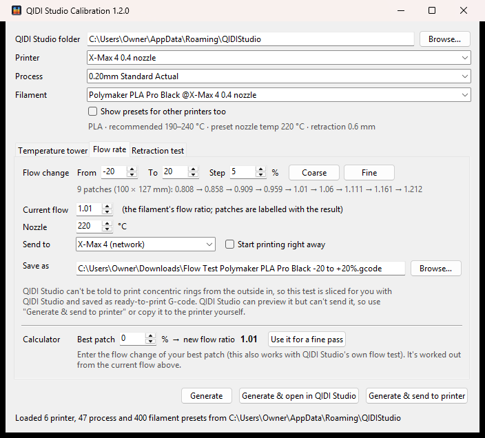

# QIDI Studio Calibration

The calibration prints QIDI Studio is missing, or still does the old way, built from your own QIDI Studio printer, process and filament presets.

| Test | What it finds | What you get |
|---|---|---|
| **Temperature tower** | The best nozzle temperature | A ready-to-slice `.3mf`. Each floor prints at a different temperature, engraved on the front. |
| **Flow rate** | The right flow ratio | Round patches with a spiral top printed in two passes, like OrcaSlicer's: the outer half from the edge in, then the inner half from the centre out. Each is labelled with its flow ratio, and there's a calculator for the next pass. |
| **Retraction** | The shortest retraction that stops stringing | Two towers whose bands use different retraction lengths, each labelled. |

QIDI Studio can't do what the flow and retraction tests need: it prints a spiral top in one go, and it can't change retraction by height. So the app slices those two tests for you with QIDI Studio, adjusts the G-code, and saves it ready to print. It can also upload the file to the network printer you set up in QIDI Studio.




## Download

Get the latest version from the [Releases page](https://github.com/SlamJammington/qidi-studio-calibration/releases/latest):

| System | File | How to start it |
|---|---|---|
| Windows 10/11 | `QidiStudioCalibration-windows.exe` | Double-click it. Nothing to install. |
| macOS (Apple silicon) | `QidiStudioCalibration-macos.zip` | Unzip, then right-click **QidiStudioCalibration** → **Open** the first time. |
| Linux (x86-64) | `QidiStudioCalibration-linux.tar.gz` | Extract, then run `./QidiStudioCalibration`. |

The apps aren't code-signed, so your system will warn you the first time. On Windows, click **More info → Run anyway**. On macOS, right-click → **Open**.

The retraction and flow rate tests need QIDI Studio installed on the same computer, because the app uses it to slice them.

## Using it

Pick your printer, process and filament, choose a test tab, then click **Generate**, **Generate & open in QIDI Studio**, or (for the flow and retraction tests) **Generate & send to printer**.

A good order is temperature, then flow, then retraction, each at the settings you found in the step before.

If your printer has a QIDI Box, the flow and retraction tabs show its slots (read from the printer) under **Send to**, so you can pick which slot the test prints from, just like QIDI Studio's own slot picker.

## Reading the results

**Temperature tower:** each 10 mm floor has a 45° and a 35° overhang, a bridge, two stringing cones and a couple of holes. Pick the floor that looks best overall. Hotter usually means stronger layers and more stringing. Cooler usually means cleaner overhangs and bridges.

**Retraction test:** print it at the temperature you picked from the tower. Look at the strings between the two towers and find the lowest band without strings or blobs. Use that band's length (engraved on the left tower) as your retraction length. Going much higher than needed can cause under-extrusion and wear on the filament.

**Flow rate test:** the two passes of each patch's spiral meet at a ring about 70 % of the way out, and any extra plastic collects there. Too much flow leaves a raised ring; too little leaves a groove or gaps along it. Pick the patch with the flattest, smoothest ring and enter the number on its tab as the filament's flow ratio. The patches are round, so the spiral has no corners, which keeps the result from depending on pressure advance (usually tuned after flow). Use **Coarse** (±20 %) first. Then enter the best patch's change in the **Calculator** and click **Use it for a fine pass** to print a ±5 % test around your new value.

## Running from source

You need [Python 3.8+](https://www.python.org/downloads/) with Tkinter, which the python.org installers include. On Linux you may need your distro's `python3-tk` package.

Download this repository (**Code → Download ZIP**, or `git clone`). Then run:

```bash
python3 qidi_studio_calibration.py
```

On Windows you can double-click `QIDI Studio Calibration.bat` instead.

## Building the app yourself

```bash
pip install pyinstaller
pyinstaller qidi_studio_calibration.spec
```

The app is created in the `dist` folder.

## License

[MIT](LICENSE). The engraved digits come from DejaVu Sans Bold, whose license is in [assets/LICENSE-DejaVu-font.txt](assets/LICENSE-DejaVu-font.txt).

QIDI and QIDI Studio are trademarks of QIDI Technology. This project isn't affiliated with them.

---

*This app was generated with [Claude](https://claude.ai), Anthropic's AI assistant.*
